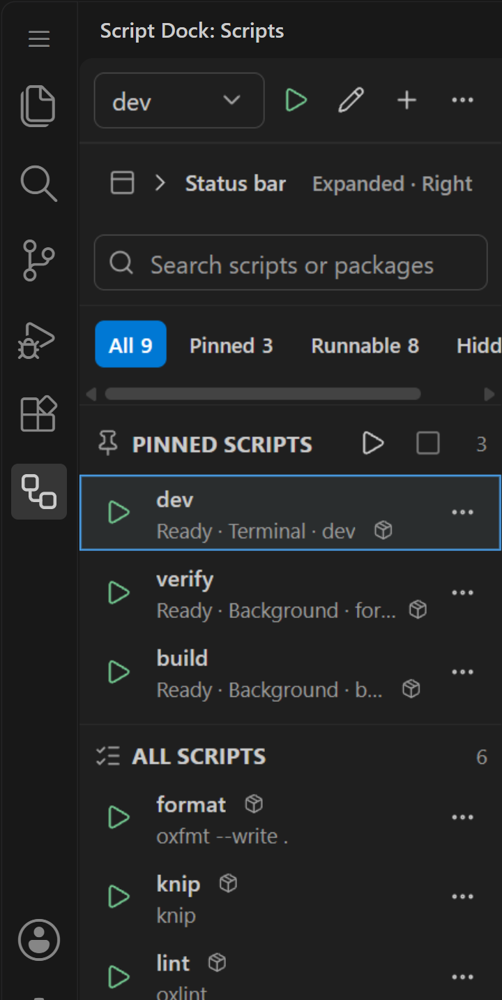
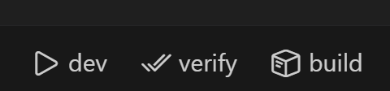

<p align="center"></p>

# Script Dock

Run workspace package scripts from a compact side panel and the status bar. See the [changelog](CHANGELOG.md) for what changed in each release.

<p align="center"></p>

## Features

### Side panel

- Pinned scripts for package scripts and script chains, kept separate from the rest of the visible scripts.
- Multi-package workspaces are grouped by package root.
- Nested Git repositories are ignored by default so opening a parent folder full of separate repos does not flood the panel.
- Search scripts across the workspace from the panel title.
- Context menu actions for pinning and unpinning scripts.
- Reorder pinned scripts from the side panel.
- Hide noisy scripts from the panel and restore them from the panel title menu.
- Pinned scripts show a warning badge when their package script no longer exists.
- Status bar scripts show health badges in the side panel.
- Native VS Code welcome content explains empty workspaces, missing package scripts, and hidden-only script lists.
- Automatic package manager detection from lockfiles.

### Status bar

- Compact mode shows one Script Dock picker instead of one item per pinned script. Move it left or right from the panel title actions.
- Expanded mode makes each pinned script its own status bar item, and can move extra scripts into a single overflow picker:

  

- Inline mode toggles let each script run in a terminal or in the background.
- Background runs show spinner, success, and failure states without focusing a terminal, and can be stopped from the side panel while they are running.
- Optional auto-close toggles for one-shot scripts after successful runs.

### Script chains

- Build a chain from the side panel, without writing JSON by hand, and edit it there after it is created.
- Suggested chains can be detected from script names and script bodies such as `format`, `lint`, `knip`, `typecheck`, `test`, and `build`.
- A chain stops at the first failed script.

### Storage

- Hidden scripts, auto-close scripts, and pinned scripts created from the UI are stored in VS Code workspace storage, not in `.vscode/settings.json`.

## Settings

The extension ships without project-specific script defaults. You can use the panel context menu to build per-workspace preferences without creating git diffs.

Run `Script Dock: Reset Workspace Preferences` from the command palette or panel title actions to clear UI-created hidden scripts, auto-close scripts, pinned scripts, and alignment for the current workspace.

Manual settings are still supported when you want checked-in team defaults:

```json
{
  "scriptDock.statusBarCommands": [
    {
      "label": "verify",
      "scripts": ["format", "knip", "build"],
      "packagePath": ".",
      "icon": "check-all",
      "executionMode": "background"
    },
    { "label": "dev", "script": "dev", "packagePath": ".", "icon": "terminal", "executionMode": "terminal" }
  ],
  "scriptDock.statusBarAlignment": "right",
  "scriptDock.statusBarDisplayMode": "expanded",
  "scriptDock.statusBarOverflowLimit": 6,
  "scriptDock.includeNestedGitRepositories": false,
  "scriptDock.statusBarPriority": 10000,
  "scriptDock.statusBarPriorityStep": 10,
  "scriptDock.hideScripts": [],
  "scriptDock.autoCloseScripts": []
}
```

## Development

```bash
bun install
bun run build
```

Open this folder in VS Code and run the `Run Extension` debug configuration. By default, the extension development host opens this repository as the test workspace.

## Credits

The icon uses the `workflow` glyph from [Lucide](https://lucide.dev) (ISC license).
